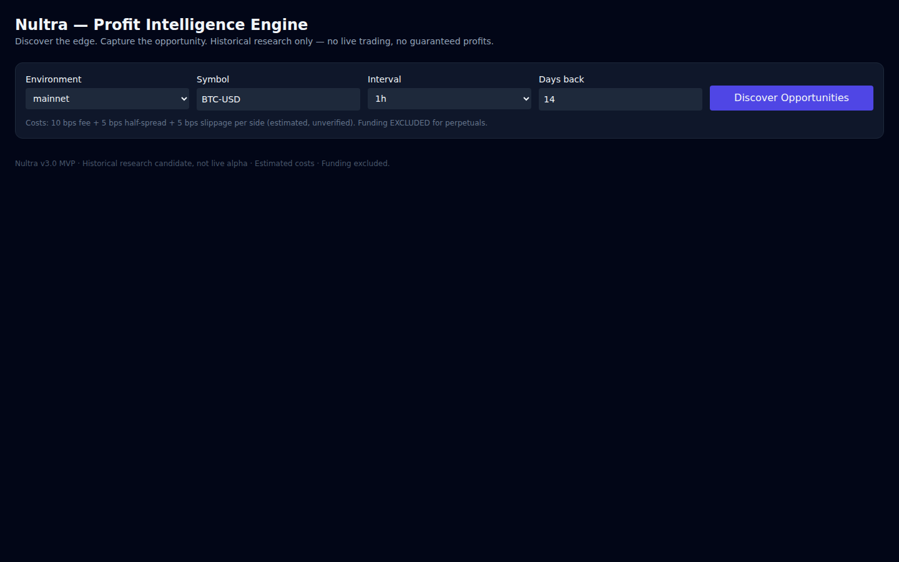

# Nultra — Profit Intelligence Engine

**Discover the edge. Challenge the evidence.**

Nultra is a browser-based quantitative research tool that discovers trading strategy candidates, backtests them against historical market data, and evaluates whether their apparent edge survives out-of-sample validation, execution costs, and robustness checks.

Instead of presenting every profitable backtest as an opportunity, Nultra is designed to reject candidates when the available evidence is insufficient.

**[Launch Live Demo](https://nultra.pages.dev)**



> Historical research only. No live trading, investment recommendations, or guaranteed returns.

## The Problem

A profitable backtest is not necessarily a profitable strategy.

Trading strategies can appear successful because of parameter sensitivity, favorable market conditions, insufficient observations, or unrealistic execution assumptions.

Finding a promising historical pattern is only the beginning. The harder question is whether that pattern remains credible when tested against data and conditions it was not optimized for.

**Nultra focuses on that second question.**

## How Nultra Works

Nultra provides an end-to-end research workflow:

**Historical Market Data → Strategy Discovery → Backtesting → Robustness Validation → Evidence-Based Verdict**

### 1. Market Data Ingestion

Retrieve historical OHLCV candles through the Strike market data API.

Nultra processes the downloaded data into a normalized dataset and generates a manifest containing provenance and integrity information.

### 2. Strategy Discovery

Explore bounded parameter combinations across three strategy families:

- **Momentum:** identifies directional price movement under configurable conditions.
- **Mean Reversion:** investigates deviations from recent price behavior.
- **Volatility Breakout:** evaluates breakouts using historical price levels and Average True Range.

Candidate generation uses deterministic rules and parameter grids, enabling reproducible experiments.

### 3. Cost-Aware Backtesting

Simulate historical strategy execution with:

- Chronological signal evaluation
- Next-bar execution
- Position sizing and quantity constraints
- Trading fees
- Bid-ask spread assumptions
- Slippage assumptions
- Trade-level PnL and equity tracking

### 4. Robustness Validation

Nultra evaluates candidates through multiple checks rather than relying on a single profitability metric.

| Validation | Purpose |
|---|---|
| Train / Validation / Holdout | Separate strategy development from evaluation |
| Walk-Forward Analysis | Examine performance across multiple historical periods |
| Transaction Cost Stress | Test sensitivity to increased execution costs |
| Parameter Neighbor Stability | Check whether nearby parameter choices produce consistent results |
| Minimum Trade Requirements | Avoid conclusions from insufficient observations |
| Sealed Holdout | Reserve the final evaluation period for the selected candidate |

The historical dataset is divided into **60% training, 20% validation, and 20% holdout**.

Historical warmup data is provided where needed for indicator calculations without permitting trades during the warmup period.

### 5. Evidence-Based Results

Nultra does not guarantee that every discovery run will produce a qualified candidate.

Results may include:

| Verdict | Meaning |
|---|---|
| `CANDIDATE — HISTORICAL ONLY` | Passed the implemented historical validation requirements |
| `REJECTED` | Failed one or more applicable validation requirements |
| `INSUFFICIENT TRADES` | Did not generate enough completed trades for evaluation |
| `INSUFFICIENT DATA` | Available market data was insufficient for evaluation |
| `NO ROBUST EDGE` | No candidate satisfied the required validation gates |

**No robust edge is a valid research outcome.**

The objective is not to force a positive result. It is to make the available evidence understandable.

## Research Transparency

Nultra exposes information that helps users inspect and reproduce experiments, including:

- Strategy family and parameter configuration
- Historical backtest metrics
- Validation metrics and rejection reasons
- Walk-forward and robustness results
- Execution-cost assumptions
- Dataset provenance
- JSON experiment export

The interface also provides diagnostic summaries showing why candidates fail validation.

## Example Research Run

A recent run on **BTC-USD, 1h, 14 days** produced the following result:

| Metric | Value |
|---|---:|
| Candidates generated | 54 |
| Qualified (`CANDIDATE — HISTORICAL ONLY`) | 0 |
| Rejected | 0 |
| Insufficient trades | 54 |
| No robust edge | Yes |

This is an expected and valid outcome: the evaluated period did not produce enough completed trades for the candidates to pass the minimum trade requirement.

Full experiment output is available in [`docs/example-run.json`](docs/example-run.json).

## Architecture

Nultra uses a TypeScript monorepo with a browser-based research interface.

```text
nultra/
├── apps/
│   ├── web/              # React research interface
│   └── api/              # Optional Worker proxy
├── packages/
│   ├── shared-types/     # Shared domain contracts
│   ├── strike-client/    # Strike API integration
│   ├── data-core/        # Historical data processing
│   ├── quant-core/       # Strategies and backtesting
│   └── validation/       # Robustness and verdict engine
├── tests/
└── docs/
```

### Technology

- TypeScript
- React
- Vite
- Tailwind CSS
- Web Workers
- Vitest
- Strike historical market data API

Validation runs inside a Web Worker to reduce blocking of the browser's main UI thread.

## Getting Started

### Requirements

- Node.js 20+
- pnpm

### Installation

```bash
git clone https://github.com/Lexiie/nultra.git
cd nultra
pnpm install
```

### Development

```bash
pnpm --filter @nultra/web dev
```

### Quality Checks

```bash
pnpm typecheck
pnpm lint
pnpm test
pnpm build
```

### Performance Testing

```bash
pnpm exec vitest run tests/perf.test.ts
```

The performance test suite includes a validation workload using 8,640 synthetic candles.

## Limitations

Nultra is an experimental historical research tool, not a production trading system.

Important limitations include:

- Historical performance does not predict future returns.
- Strategy discovery is limited to the implemented hypothesis families and parameter grids.
- Execution costs are modeled assumptions rather than guaranteed live fills.
- Funding payments are not included in the current backtest model.
- Market conditions may change substantially outside the evaluated period.
- A historically qualified candidate is not a recommendation to trade.
- Nultra does not place live orders or manage trading accounts.

## Project Documentation

Additional implementation details and decision history are available in:

- `DECISIONS.md` — recorded deviations, API uncertainties, and locked decisions
- `docs/` — repository notes (if present)

---

**Nultra — Profit Intelligence Engine**

*Discover the edge. Challenge the evidence.*